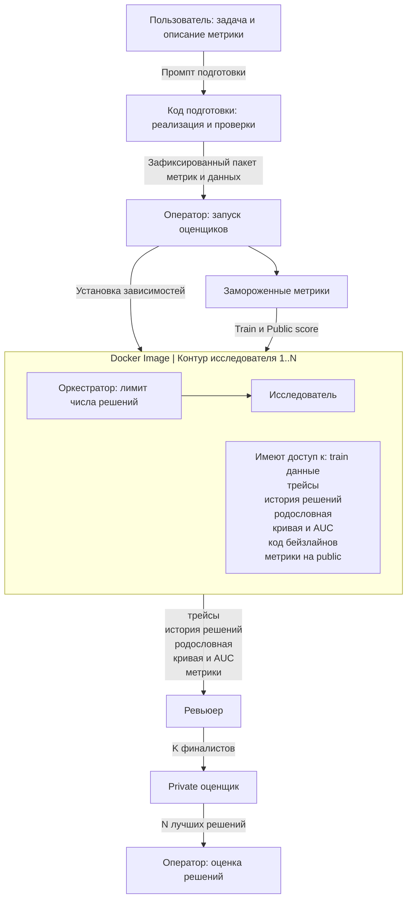

# Как устроена арена

AR-12 использует протокол Arena, общий журнал поиска и изолированные оценщики. Агентные роли задаются промптами из `arena/prompts/`; условия конкретного запуска находятся в каталоге кампании.

- [Роли участников](#сущности-арены).
- [Видимость train, public и private](#видимость-данных).
- [Лимит предложений](#лимит-решений).
- [Журнал, родословная, снимки, кривая и AUC](#артефакты-кампании).
- [Отбор финалистов и закрытая оценка](#финализация).
- Граница изоляции в моей установке — [пилот AR-12 и запуск с закрытыми выборками](#границы-изоляции).
- Smoke-проверки арены — [команды и результаты](#smoke-проверки).




## Сущности арены

| Роль | Границы | Зачем нужен |
| ---- | ------- | ----------- |
| Код подготовки | Весь репозиторий | Проверка кодом: проверяет метрику, замораживает пакет данных и split, а также условия кампании|
| Оператор | Весь репозиторий | Студент: устанавилвает зависимости, ставит границы доступа, разворачивает оценщики |
| Оркестратор | Только текущая кампания, train-set целиком, score по public-set. Остальное недоступно | Агент: планирует поиск, следит за лимитами попыток, запускает исследоватей, выбирает и замораживает финалистов |
| Ревьюер | Код, журнал, train и общий public-score текущей кампании | Агент: проверяет версии, соблюдение правил и качество изменений |
| Private оценщик | Private текущей кампании, пакет метрики и замороженные пакеты финалистов | Сервис запускает финалистов на private и выбирает лучшие решения |

## Видимость данных

| Set | Кто видит | Для чего нужен и от чего защищает |
| --- | --------- | ---------------- |
| train | Все | Тренировочные данные могут видеть все |
| public | Оператор и public-оценщик. Оркестратор, исследователи и ревьюер видят общий балл и статус | Даёт обратную связь по кандидатам, сохраняя примеры и метки закрытыми |
| private | Оператор и private-оценщик | Проверка замороженных финалистов после завершения поиска |

Таблица описывает видимость в кампании с закрытыми выборками. Фактический доступ в пилоте AR-12 описан ниже.

## Лимит решений

Одно предложение — зарегистрированная неизменяемая версия кандидата с гипотезой и родителями. Регистрация расходует место до оценки, включая случай ошибки подготовки или запуска. Техническое продолжение прежнего замера сохраняет ID кандидата и занимает то же место.

Пилот предлагает лимит шесть — три бейзлайна и по одному новому варианту каждого. Для основной кампании лимит фиксируется в условиях и каноническом журнале до поиска. Оркестратор распределяет оставшиеся места между направлениями и сохраняет отрицательные результаты.

Токены и время каждого этапа измеряются. Умножение среднего расхода на лимит даёт прогноз затрат; фактическая стоимость зависит от длины исследования, обучения и повторов.

## Артефакты кампании

После завершения кампании, на выходе должны быть следующие артефакты:

Родословная — ориентированный граф без циклов c дервом версий, который выглядит как json файл:

```json
[
  {"candidate_id": "baseline", "parents": []},
  {"candidate_id": "v1", "parents": ["baseline"]},
  {"candidate_id": "v2", "parents": ["v1"]},
  {"candidate_id": "v3", "parents": ["v1"]}
]
```

Снимок хранит весь автономный пакет кандидата на момент регистрации, включая `solve.py`, конфигурацию и обученные артефакты. Журнал позволяет восстановить эту версию после изменения рабочей копии.

Кривая показывает лучший известный score при текущем числе предложений. Новый результат появляется в точке, равной числу предложений на момент завершения замера. AUC — площадь под ступенчатой кривой. При одинаковых условиях и бюджете более раннее улучшение увеличивает AUC для максимизируемой метрики. Сравниваются замеры одной выборки и одних условий.

Журнал, который содержит в себе:

1. Кампания. Лимит предложений, сколько уже зарегистрировано и остановлен ли поиск.
2. Кандидат. ID, порядковый номер предложения, ID родителей, гипотеза, описание изменения, снимок файлов, затраты времени и токенов. Неудачные предложения тоже сохраняются и расходуют лимит.
3. Замер. ID замера и кандидата, выборка (train или public), версия датасета и условия оценки, статус и score. Для кривой и AUC нужны порядок завершения замеров и число зарегистрированных предложений на момент завершения каждого замера. Для train хранятся подробности сылки на трейсы. Для public сохраняются общий score и статус, а при сбое — общий код ошибки. Результаты private хранятся у оператора.

## Финализация

После исчерпания лимита или явной остановки пользователем оркестратор выбирает ровно K финалистов по качеству, разнообразию, устойчивости и полезности закрытой проверки. Независимый ревьюер проверяет их снимки и допустимость. Все K передаются одним замороженным пакетом на private.

Private-сервис выбирает ровно N лучших, где N ≤ K. Сначала учитывается score, затем полнота учёта токенов решателя, меньшее число токенов и меньшее время решения. При полном равенстве используется порядок ID. Результаты видит оператор.

Пилот с пустым private заканчивается сохранённым выбором по train. Для выполнения требований B-4.2 и B-5.1 проекта нужна отдельная полная кампания с непустым private, зафиксированным до поиска. Основная метрика также требует доверенного замера прогретого инференса для p99 и пропускной способности.

## Границы изоляции

### Пилот AR-12

- **Данные и оценщик.** На машине оператора в `case/dataset/ar12-pilot-v1/data/` лежат `train.jsonl` (14 025 примеров для обучения) и `evaluation.arena.jsonl` (256 примеров для train-оценщика). В пилоте `public` и `private` пусты. Проверочная подвыборка воспроизводится из исходного train и списка ID в репозитории. [Подготовка данных](../case/campaign/ar-12-pilot/preparation.md)
- **Агентный поиск.** `case/agents/run.py` запускает роли подготовки, оркестратора, исследователя и ревьюера через Hermes с промптами из `arena/prompts/`. Существующие команды `evaluator.search`, `evaluator.train` и `evaluator.client` предоставляют журнал, оценку и финализацию.
- **Рабочее окружение.** `case/deploy/agents.py` подготавливает рабочую копию текущей кампании и запускает роль в Docker. Оператор выдаёт разрешённые данные train, канонический журнал, модельный доступ и адреса API. Модель с доступом к данным кейса использует внутренний endpoint по условиям кампании. Порядок подготовки образа, сети и mounts необходимо проверить перед реальным поиском.
- **Runner оценки.** Оценщик запускает одноразовый контейнер на каждый пример. Он получает пакет кандидата и один вход, работает без сети и с корневой файловой системой в режиме чтения. Обучение выполняется в ограниченной рабочей среде исследователя. [Граница runner](seminar-boundaries.md)


### Кампания с закрытыми выборками

- **Оператор** хранит `public` и `private` вне рабочих каталогов агентов, под отдельной учётной записью. Каждый оценщик получает доступ только к своей выборке. Закрытые результаты финализации доступны оператору.
- **Оркестратор и исследователи** работают в Docker-контейнерах с рабочими материалами только текущей кампании. Исследователи пишут в собственные рабочие каталоги, а оркестратор ведёт общий журнал. Ревьюер получает код, журнал, `train` и общие результаты `public` той же кампании. Для доступа к `public` используется токен текущей кампании. Оценщик проверяет принадлежность кампании и кандидата на сервере и возвращает статус и общий балл. Ограничения файловой системы и сети распространяются на shell и остальные инструменты агентов.
- **Код кандидата** обучается в отдельном контейнере с разрешёнными данными `train` и каталогом для выходного пакета. Для оценки используется отдельный runner без сети. Закрытые файлы, журналы оценщика, учётные данные оператора и Docker socket находятся вне окружений агентов и кандидата. Оператор передаёт замороженные пакеты финалистов на `private`.

## Smoke-проверки

Команды запускаются из корня репозитория после [подготовки окружений, стартовых пакетов и образа runner](../case/campaign/ar-12-pilot/launch.md#подготовка-и-приёмка).

```bash
campaign=case/campaign/ar-12-pilot

(cd arena && timeout 60 .venv/bin/python -m evaluator.smoke)
PYTHONPATH=arena arena/.venv/bin/python -m evaluator.prepare verify --metric "$campaign/metric"
.venv/bin/python -m pytest -q case/metric/tests
.venv/bin/python case/deploy/arena.py --campaign "$campaign" accept
```

**Результаты приёмки AR-12 от 6 ноября 2026 года**

- **Ядро Arena.** Smoke прошёл. Он проверяет расчёт метрик, доступ к общему `public`-баллу и финализацию на синтетической `private`-серии.
- **Метрика AR-12.** Пакет метрики прошёл проверку, тесты прошли 18 из 18.
- **HTTP, Docker и журнал.** Контрольный кандидат, три бейзлайна и тестовый `variant-matching` прошли сквозную оценку на двух синтетических примерах. Контроль получил `score = 1`. Записи оценки и финализации сохранились в отдельном журнале `case/campaign/ar-12-pilot/.run/acceptance-h9ff9anm/journal.json`.
- **OpenRouter.** Команда `.venv/bin/python case/deploy/arena.py --campaign "$campaign" openrouter-smoke` с настроенным ключом отправила один синтетический запрос. Результат — 53 токена за 0,94 секунды, запись в `case/campaign/ar-12-pilot/.run/openrouter-smoke.json`.

**Повторная локальная проверка 15 ноября 2026 года.** Проверка пакета метрики прошла, тесты метрики дали 18 из 18. Smoke ядра завершился по таймауту 60 секунд с кодом 124. Docker-приёмка и OpenRouter приведены по записи от 6 ноября.

Проверка доступа из контейнеров оркестратора и исследователей к закрытым выборкам и соседним кампаниям остаётся задачей запуска с закрытыми данными.

[Запись о приёмке](../case/campaign/ar-12-pilot/preparation.md) · [Полные команды smoke-проверок](../case/deploy/README.md)
